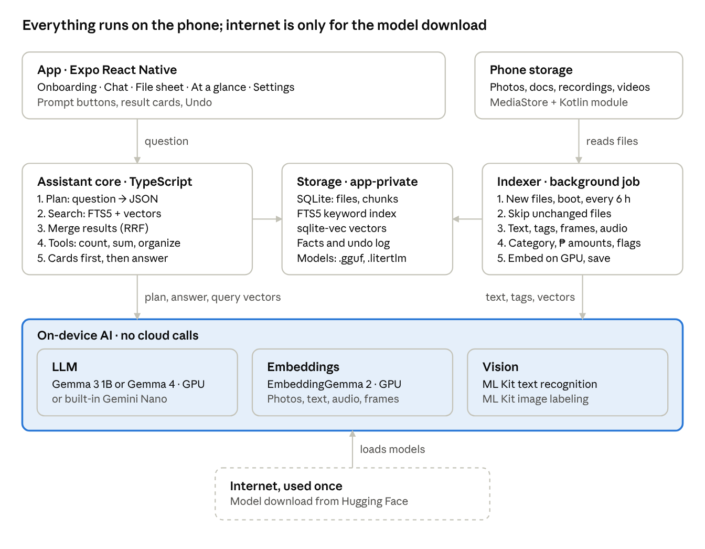
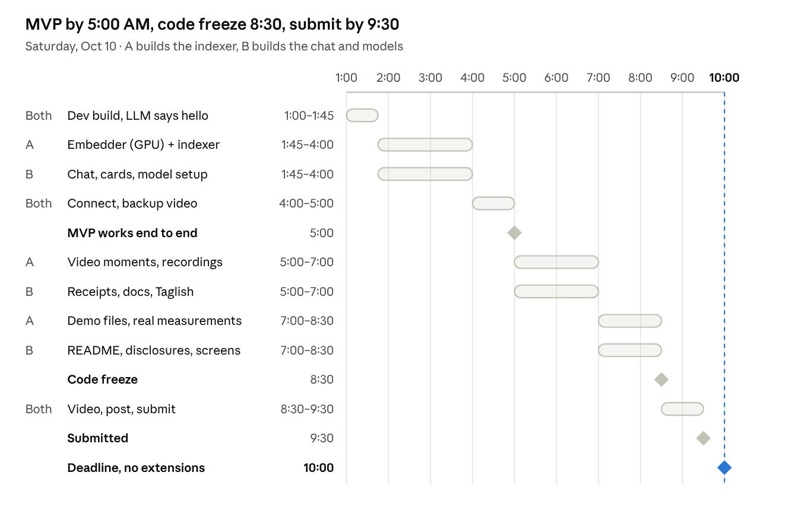

# AiFoundIt — App Design & Functional Spec

Oct 10, 2026 · @Jeanson Avenilla

## Overview

AiFoundIt is a private search assistant for your phone. You ask in English or Taglish, and it finds the photo, receipt, document or recording you mean. It runs offline and never uploads anything.

**Problem.** Phones pile up thousands of files: GCash and Maya receipt screenshots, photos of IDs, school and work PDFs, Messenger downloads, voice notes. File managers only search by file name. Google Photos only searches photos, and it processes them in the cloud. So people scroll for minutes, or ask someone to send the file again.

**Target users.**

- Students with modules, handouts, thesis PDFs and screenshots of announcements.
- Workers and freelancers who need receipts for reimbursement, payslips, contracts and ID photos for requirements.
- Anyone who pays with e-wallets and keeps proof-of-payment screenshots.

**Why it needs local AI (our submission answer).** The index is a map of someone's private life: IDs, receipts, bank screenshots, personal photos. Few people would upload that to a cloud AI, and doing it would cost mobile data plus a fee per API call. On the phone it is free after setup, instant, and works with no signal. Take away the local AI and nothing is left: every search, description and action runs on the device.

## Features

The MVP is chat search over photos and screenshots, with a model download and scan rules. Everything else is added only once the MVP works end to end.

| Feature | What it does | Priority |
| --- | --- | --- |
| Chat search | Ask for a file in plain English or Taglish and get matching files back | MVP |
| Result cards | Preview (thumbnail, page or frame), name, folder, date, matched words highlighted. Open in AiFoundIt's viewer or another app, show in folder, share, copy path. | MVP |
| Photo understanding | Reads the text in every photo and screenshot (OCR), tags what is in it, and stores an image vector so photos are found by what they show | MVP |
| Describe and ask | Ask about one photo or recording, for example "What's in this photo?". Gemma 4 E2B or E4B answers, and the answer is saved as the file's description, which can also be searched. | If time |
| Taglish questions | The LLM rewrites any question into search keywords and filters | MVP |
| Phone at a glance | After the first scan: counts of receipts, IDs, school files, screenshots, and so on | MVP |
| Scan rules | Scans the whole phone by default, skips the default exclusions, plus folders the user adds or excludes | MVP |
| Model setup | Checks the phone, recommends a model, downloads it with progress, or imports it from a file | MVP |
| Documents | Text from PDF, Word, Excel, PowerPoint, EPUB, TXT, MD, CSV, HTML and similar files (PDF text needs the Kotlin module) | If time |
| Receipt math | "How much did I spend this week?" Amounts are read by code and summed by code, never by the LLM. | If time |
| Privacy guard | Flags photos of IDs and screenshots showing an OTP or password, and offers to move them to a private folder | If time |
| Organize | Move, copy, rename and organize into folders by instruction, with three approval modes: Plan, Ask each, Auto. Everything can be undone. | If time |
| New-file updates | Indexes new photos, videos, recordings and documents in the background, including after a reboot, without opening the app | If time |
| Phone's built-in AI | Uses Gemini Nano on phones that have it, instead of the downloaded model | Later |
| Voice recordings | Finds recordings by what is in them, using audio vectors from EmbeddingGemma 2, and plays from the matching moment | If time |
| Video | Video moments: finds the moment in a video that matches a query, using keyframe vectors, and plays from that time | If time |
| iOS | Same app on iPhone, using Apple's on-device model when available | Later |

## Screens and user flows

The app has five screens, and the chat is home. A first-time user goes from install to their first search in about three taps plus the model download.

| Screen | What is on it |
| --- | --- |
| Onboarding | 1. Promise: "Your files never leave this phone." 2. Permissions: Photos and media, All files access (optional, for documents), notifications. 3. AI setup: phone check (RAM, free storage), the recommended model, then Download, Use built-in phone AI (if available) or Import from file. 4. First scan with live progress. |
| Chat (home) | Message list, suggested prompt buttons in English and Taglish, text input. Each answer shows result cards first, then a 1–3 sentence reply, then a proof line: "Found in 0.4 s · on-device · 0 bytes sent". |
| File sheet | Opens from a result card. Preview in AiFoundIt's viewer: zoomable image, PDF pages, text with matches highlighted, and video or audio starting at the matched moment, AI description, extracted text (copyable), tags, folder path, date. Buttons: Open with another app, Show in folder, Share, Copy path, Ask about this file. |
| At a glance | Tiles with counts: Receipts, IDs, School, Work, Screenshots, Memes, Documents. Tapping a tile opens a filtered list. Also the landing screen after the first scan. |
| Settings | Scan folders (included and excluded), Models (active, installed, download, delete), Index (status, rescan, delete index), Privacy (private folders, data-sent counter). |

**Flow: find a file**

1. The user types or taps a prompt: "Nasaan yung resibo ko sa Jollibee?"
2. Result cards appear within about a second. The LLM's sentence streams in under them.
3. Tapping a card opens the file sheet. Open hands the file to the phone's default app.
4. Follow-ups refer to the last results: "open the second one", "move those to Receipts".

**Flow: organize**

1. The user asks: "Put all my receipts in a Receipts folder."
2. The app shows a plan: the file list, the destination folder and the count.
3. The user taps Confirm. Android may show its own permission dialog for files other apps created.
4. The files move, and an Undo button stays visible for 30 seconds. Every move is logged, so it can also be undone later from Settings.

**Flow: first run**

1. Grant permissions, then pick a model. Download starts and shows progress.
2. Scanning starts at the same time. Text reading, tags and keyword search need no download, so they run right away. Embeddings are filled in once the embedding model arrives.
3. Priority folders go first: Camera, Screenshots, Download, Documents. Search works within the first minute and gets better as the scan continues.
4. When the scan ends, the app opens At a glance.

## What users can ask

Every question becomes one of seven intents. Only describe needs the LLM to read file content; the others are search, SQL or file operations.

| Intent | English example | Taglish example | What the app does |
| --- | --- | --- | --- |
| Find | "Find my PhilHealth ID photo" | "Nasaan yung picture ng PhilHealth ID ko?" | Hybrid search, then result cards |
| Find by content | "The PDF that mentions the thesis defense schedule" | "Yung PDF na may thesis defense schedule" | Keyword and semantic search over the extracted text, matched words highlighted |
| Describe | "What's in this file?" · "Summarize last week's contract" | "Ano laman nitong file?" | The LLM reads that file's extracted text and summarizes it |
| Compute | "How much did I spend on GCash this week?" | "Magkano nagastos ko sa GCash this week?" | Amounts pulled out of receipts by code, filtered by date, summed in code. Shows the total and each receipt. |
| Count | "How many screenshots do I have?" | "Ilan screenshots ko?" | SQL count by category, type or folder |
| Privacy | "Do I have photos of my IDs?" | "May picture ba ako ng ID ko?" | Lists files flagged sensitive and offers to move them to a private folder |
| Organize | "Put all my receipts in a Receipts folder" | "Ilagay mo lahat ng resibo sa isang folder" | Plan, then confirm, then move, with undo |

When nothing scores above the match threshold, the app says so and suggests a better query. It never guesses a file.

## Architecture

Five parts: the app, an assistant core that answers questions, an indexer that reads files, SQLite storage, and the on-device models both of them call.



The assistant core and the indexer never call a server. The model download is the only network traffic, and it happens once during setup.

## Folder scan rules

By default the app scans the whole phone, skips a built-in exclusion list, and scans priority folders first. Users can add folders, exclude folders, or switch to scanning only selected folders.

**Two modes.**

- **Whole phone (default):** every folder under internal storage and the SD card, minus the exclusions below.
- **Selected folders only:** just the priority folders plus the folders the user adds. This is for people who want a smaller, faster index.

**Priority folders.** These are scanned first so search is useful within the first minute. In selected-folders mode they are the default include list.

- DCIM/Camera, Pictures/Screenshots, DCIM/Screenshots
- Download, Documents
- Pictures/Messenger, Pictures/Viber, Pictures/Telegram, Download/Telegram
- Android/media/com.whatsapp/WhatsApp/Media (images and documents)
- Recordings, Music/Recordings (for voice notes, later)

**Default exclusions.**

| Skipped | Why |
| --- | --- |
| Android/data, Android/obb | Other apps' private data. Android blocks access anyway. |
| Folders whose name starts with a dot (.thumbnails, .cache, .Statuses) | Hidden caches and thumbnails, not the user's files |
| Folders containing a .nomedia file | Apps mark caches and sticker packs this way. A Settings switch can include them. |
| Folders named cache, tmp, temp or logs | App leftovers |
| Files in the Android trash | The user already deleted them |
| Images under 10 KB or smaller than 200 × 200 px | Icons and stickers |
| Documents over 100 MB | Too slow to read. Only the file name and details are indexed. |
| AiFoundIt's own folders | Model files and exports |

**User rules.**

- Add a folder to scan, for example a folder on the SD card.
- Exclude a folder, for example "Bank" or "Private". Its files are removed from the index right away and never opened again.
- Turn file types on or off: images, documents, audio, video.

**Which rule wins.** A path is checked in this order:

1. On the user's exclude list: skipped.
2. On the default exclusion list: skipped, unless the user added that exact folder.
3. Whole-phone mode: scanned. Selected-folders mode: scanned only if it is under an included folder.

**Android limits.** Scanning documents across the whole phone needs the All files access permission. Without it, the app still indexes photos, videos and audio, but documents only from folders the user picks, and Android 11 and later won't let the picker select the Download folder itself. Google Play lists on-device file search as an allowed use of All files access, after a declaration. Check the current Play policy before publishing.

## Indexing pipeline

Each file goes through seven steps, and only new or changed files are processed again. Rules and code do most of the work. Models are used only where rules can't do the job.

1. **Discover.** Walk the included folders (native module, for speed) and query MediaStore for media. Result: path, size, modified time and type for every candidate.
2. **Detect changes.** Compare path, size and modified time with the files table. New and changed files go on, deleted files are removed from the index, and unchanged files are skipped.
3. **Extract** text and tags by file type (table below).
4. **Enrich, rules first.** Category (receipt, ID, school, work, screenshot, meme, document) from keywords in the text plus the image tags. Facts: ₱/PHP amounts, dates, merchant names. Sensitive flags: ID card words and numbers, OTP, password. Optional, only while charging: the LLM writes a one-line description of documents and receipts.
5. **Chunk.** Each file gets a card text: name, folder, tags, category and its first lines. Long text is split into chunks of about 800 characters that overlap, and each chunk keeps its page number.
6. **Embed.** Each text chunk, photo, video keyframe and audio chunk gets a vector from EmbeddingGemma 2 on the GPU. They all share one vector space, so one query searches them together.
7. **Save.** One SQLite transaction per batch of about 20 files, covering files, chunks, the keyword index and the vectors.

| File type | Extractor | Output |
| --- | --- | --- |
| Images and screenshots | EmbeddingGemma 2 image encoder, ML Kit text recognition, ML Kit image labeling, EXIF | Image vector, text, tags with confidence 0.6 or higher, date taken, screenshot flag from the folder. Optional: Gemini Nano image description on supported phones. |
| PDF | PdfBox-Android in the Kotlin module, first 30 pages | Text by page. A scanned PDF with no text gets its first 3 pages rendered and read with OCR instead. |
| DOCX, XLSX, PPTX, ODT, EPUB | JSZip, then strip the XML tags from the document, sheets, slides or chapters | Text by page, sheet, slide or chapter |
| TXT, MD, CSV, JSON, XML, HTML, RTF, logs | Read the first 200 KB, stripping HTML and RTF markup | Text |
| Recordings | Kotlin module: decode to PCM, then embedAudio | One vector per 10-second chunk, with start and end times |
| Video | Kotlin module: keyframes from the hardware decoder, audio track through MediaCodec | One vector per keyframe and per audio chunk, with times |

**Scheduling.**

- **First scan:** runs with the app open and shows progress, for example "1,240 of 3,910 files · 37 receipts found". Priority folders go first, and the newest files go first within each folder.
- **After that:** background indexing (see Background indexing), plus a quick check every time the app opens and on pull-to-refresh.
- **Battery:** pause below 20% unless charging. Work in small batches and run heavy steps natively so the chat stays smooth.
- **Built-in phone AI:** Gemini Nano only runs while the app is on screen, so it can't be used for background indexing.

## How a photo is understood

Each photo is stored in three layers, so it can be found by what it shows, by the words in it, and later by its description.

| Layer | When it's made | Made by | Finds the photo by |
| --- | --- | --- | --- |
| Image vector | Every scan | EmbeddingGemma 2 image encoder | What it shows: "dog at the beach", "red dress", "a receipt" |
| Text in the photo | Every scan, for photos with text | ML Kit OCR. Saved in FTS5 and also embedded as a text vector. | Exact words and numbers: "Jollibee", "₱345", a reference number |
| Description | When the user asks about the photo. Later, also in the background while charging. | Gemma 4 E2B or E4B, given the image, its OCR text and its tags | Everything the description says, from then on |

- **Does the image vector include the text?** Partly. It may pick up big words such as a store logo, but not small print such as amounts, dates or ID numbers. Test it on the demo receipts. That is why OCR text gets its own keyword entry and its own vector.
- Skip the text vector when OCR finds fewer than 10 characters.
- **Describe on demand.** The user asks "what's in this photo?" or taps Describe. Gemma 4 gets the image, the OCR text, the tags and the question. Its answer is saved as the photo's description and embedded as one more chunk (kind = description), so the index improves as it's used.
- Totals still come from the OCR text and code, never from a description.
- With a text-only model (Gemma 3 1B), the Describe button is replaced by an offer to download Gemma 4.

## Video moments and recordings

Videos and voice recordings work like Edge Gallery's Video Moments Finder. Each file is cut into short pieces, each piece gets a vector from EmbeddingGemma 2, and a search jumps straight to the matching moment. No transcripts or captions are needed.

**Video moments.**

1. **Pick frames** with `MediaMetadataRetriever.getScaledFrameAtTime`, asking for the nearest keyframe at about 512 px. The hardware decoder does this quickly. Take 1 frame every 2 s for videos up to 2 minutes, every 5 s for longer ones, at most 120 frames per video.
2. **Embed each frame** on the GPU. Drop a frame whose vector is almost the same as the previous frame's (cosine above 0.95), so a still scene isn't stored 30 times.
3. **Embed the sound** (740M model only): cut the audio track into 10-second chunks, the same way as recordings.
4. **Save** each piece as a chunk with its kind (frame or audio) and its start and end time.
5. **Show results** with the matched frame as the thumbnail and its time ("0:42"). Tapping plays the video from that moment with expo-video.

Videos under 15 minutes are indexed fully. Longer ones get only file details and a thumbnail unless the user turns on "Index long videos". Videos go last in the scan, ideally while charging.

**Recordings.**

1. **Find them** with MediaStore's IS\_RECORDING flag (Android 12 and later) and in the Recordings and Music/Recordings folders. Skip music (IS\_MUSIC) by default.
2. **Decode** m4a, aac, amr, mp3 or ogg to mono PCM with MediaExtractor and MediaCodec in the Kotlin module. Use the sample rate the Universal Embedder guide asks for.
3. **Cut** into 10-second chunks with 2 seconds of overlap, and embed each chunk with `embedAudio`.
4. **Show results** with the recording, the matching time and a play button that starts there (expo-audio).
5. **Test spoken words early.** Audio vectors may match what a recording is about better than exact phrases. If a query like "the recording where I said Friday 3 PM" fails, add transcription later with whisper.rn on the same PCM.

**Index status.** Each file keeps a status for each step: text, vector, frames, audio. A scan can stop and resume, and a model added later only runs the missing step. Settings shows:

- counts by type: photos, documents, videos, recordings
- files pending, and files that failed, with Retry
- last scan time and index size
- the embedding model in use, with Rebuild index when it changes

## Background indexing

After the first launch, AiFoundIt keeps its index up to date by itself, even after a reboot, without the app being opened. Android's WorkManager runs the jobs, and the whole heavy pipeline runs natively in Kotlin.

| Trigger | What runs | Android mechanism |
| --- | --- | --- |
| A new photo, video or recording is saved (camera, screenshot, Messenger download) | Index just the new files | WorkManager one-time work with a content URI trigger on MediaStore images, video and audio. Re-queued after each run. |
| Every 6 hours | Full change check: new, changed and deleted files, including PDFs and other documents | Periodic WorkManager job, only while charging and battery not low. The shortest allowed interval is 15 minutes. |
| The phone restarts | Nothing extra: WorkManager restores its jobs after a reboot by itself. An optional boot receiver queues one catch-up scan. | WorkManager's own boot handling, plus RECEIVE\_BOOT\_COMPLETED |
| First scan, or many new files | A long run with a progress notification: "Indexing 1,240 of 3,910" | Long-running worker with setForeground, foreground service type dataSync |
| The app is opened | A quick change check, then the merge below | The same Kotlin code, called from JavaScript |

**How the worker shares the database.** The worker runs without JavaScript, and sqlite-vec is loaded only on the JavaScript side, so the worker never writes to the main database. Instead:

1. The worker does the heavy work natively: OCR, tags, PDF text, and vectors for photos, frames and audio.
2. It writes the results to a small inbox database: file details, text, and vectors as BLOBs.
3. When the app opens, JavaScript drains the inbox into the main database in one transaction, adding category rules, amounts, FTS5 rows and sqlite-vec rows.
4. Search is complete as soon as the merge finishes, which is a quick step because the heavy work is already done.

**Limits to know.**

- The user has to open the app once, to grant permissions and get the models. After that it runs on its own.
- If the user force-stops the app in Settings, Android cancels its jobs until the app is opened again.
- Many phones sold in the Philippines (Xiaomi, OPPO, vivo, realme, Infinix, Huawei) kill background apps aggressively. Onboarding asks the user to allow Autostart and turn off battery optimization, with a button that opens the right settings screen.
- Android 15 doesn't let a boot receiver start a dataSync foreground service directly, so the receiver only queues WorkManager work.
- Gemini Nano can't run in the background. The downloaded models can.
- iOS (later) is stricter: background work runs only when iOS decides, usually overnight while charging, and nothing starts on boot.

**For the hackathon.** Build Scan now and scan-on-open first; background work is If time. The new-photo trigger is the most valuable piece, because it enables this demo: take a photo with the normal Camera app, then open AiFoundIt and find it already indexed. Test the trigger delay on the demo phone first. If it's slow, use pull-to-refresh on stage.

## Speed: GPU and native code

Heavy work runs in native code, on the GPU wherever the library allows it. JavaScript only moves small results around. Only report speed numbers you measured on the demo phone.

| Part | Runs on | How |
| --- | --- | --- |
| Embeddings: photos, text, video frames | GPU | MediaPipe Universal Embedder with `setVisionDelegate(Delegate.GPU)` and `setTextDelegate(Delegate.GPU)`. Fall back to CPU if GPU setup fails. |
| Embeddings: audio | GPU if the API offers it, otherwise CPU | `embedAudio` in the same module |
| Chat LLM | GPU on Snapdragon phones with an Adreno 700 or newer, CPU elsewhere | llama.rn with `n_gpu_layers` set high (for example 99). After `initLlama`, check its `gpu` and `reasonNoGPU` fields. OpenCL needs expo-build-properties. |
| OCR and tags | ML Kit's own optimized runtime | Nothing to set |
| Video frames | Hardware video decoder | `getScaledFrameAtTime` returns small frames directly |
| Audio decoding | MediaCodec | Decode once, then reuse the PCM for every chunk |
| Photo decoding | CPU | `BitmapFactory` with `inSampleSize`, so a 12 MP photo decodes at about 512 px |
| Vector search | CPU, inside SQLite | sqlite-vec with 256-number vectors |
| Gemma 4: Describe and better chat | GPU, with vision on the GPU and audio on CPU or GPU | LiteRT-LM with EngineConfig(backend = Backend.GPU(), visionBackend = Backend.GPU()). Declare libOpenCL.so and libvndksupport.so as optional uses-native-library entries. engine.initialize() can take up to 10 s, so start it in the background at app launch. |

**Rules that keep it fast.**

- Load each model once and keep it loaded. Never reload per file.
- Run 2–3 decode workers (Kotlin coroutines on `Dispatchers.IO`) feeding a single GPU embedding queue.
- Send results to JavaScript in batches of about 20 and save each batch in one transaction.
- Return vectors as `Float32Array`, already cut to 256 numbers and normalized. Expo modules support typed arrays.
- **Search as you type:** embed the query natively, wait about 150 ms after the last key, run the sqlite-vec search and show cards. The LLM writes its sentence only when the user presses send.
- Never run indexing on the JavaScript thread. Send a progress event every 20 files.
- Long first scans heat the phone. Read `PowerManager.getCurrentThermalStatus()` (Android 10 and later) and slow down when it reports throttling.

**The Kotlin module's API.** This is the whole surface JavaScript sees. Everything behind it is native.

```ts
interface AiFoundItNative {
  // embeddings: EmbeddingGemma 2 through MediaPipe (vectors cut to 256 numbers, normalized)
  loadEmbedder(modelPath: string, opts: { gpu: boolean; dims: 256 }): Promise<{ gpu: boolean; error?: string }>;
  embedText(text: string): Promise<Float32Array>;
  embedImages(paths: string[]): Promise<Float32Array[]>;
  embedVideo(path: string, opts: { everyMs: number; maxFrames: number }):
    Promise<{ kind: 'frame' | 'audio'; startMs: number; endMs: number; vector: Float32Array }[]>;
  embedAudio(path: string, opts: { chunkMs: number; overlapMs: number }):
    Promise<{ startMs: number; endMs: number; vector: Float32Array }[]>;

  // LLM: Gemma 4 through LiteRT-LM; tokens arrive as onToken events
  loadLlm(modelPath: string, opts: { backend: 'gpu' | 'cpu'; visionGpu: boolean }): Promise<{ backend: string; error?: string }>;
  chat(requestId: string, prompt: string, attach?: { imagePath?: string; audioPath?: string }): Promise<void>;
  stopChat(requestId: string): Promise<void>;

  // background indexing (WorkManager); the worker writes to the inbox database
  scheduleBackground(opts: { everyHours: number; requireCharging: boolean; watchNewMedia: boolean }): Promise<void>;
  cancelBackground(): Promise<void>;
  runScanNow(): Promise<void>;
  drainInbox(limit: number): Promise<InboxItem[]>;  // returns finished items and removes them from the inbox
  openBatterySettings(): Promise<void>;

  // files and previews
  listFiles(roots: string[], excludes: string[]): Promise<{ path: string; size: number; modifiedAt: number }[]>;
  readPdfText(path: string, maxPages: number): Promise<string[]>;
  thumbnail(path: string, opts: { size: number; page?: number; atMs?: number }): Promise<string>;  // cached image path
  openFile(path: string, how: 'default' | 'chooser'): Promise<void>;
  showInFolder(path: string): Promise<boolean>;  // false: fall back to Copy path

  // file actions; progress arrives as onFileOpsProgress events
  runFileOps(batchId: string, ops: FileOp[]): Promise<FileOpResult[]>;
  undoBatch(batchId: string): Promise<FileOpResult[]>;

  // proof for the demo
  bytesSent(): Promise<number>;
}
type FileOp = { op: 'mkdir' | 'move' | 'copy' | 'rename' | 'trash'; from?: string; to: string };
// events: onToken · onChatDone · onIndexProgress · onFileOpsProgress
```

## Search and answers

Search is hybrid: keyword and semantic results are merged. The answer is written only from files that were actually found, so the LLM can't invent a file.

1. **Plan.** The LLM gets the question and today's date and must reply with JSON that fits a schema: intent, English query, keywords, file types, date range, category, folder. llama.rn can force output to follow a JSON schema. This is where Taglish becomes English keywords and "last week" becomes real dates. If parsing fails, the raw question is used as the query.
2. **Retrieve, two searches at once.**
   - Keyword: an FTS5 match on the keywords, ranked by BM25, top 50 chunks.
   - Semantic: embed the query once and compare it with every vector (text chunks, photos, video frames, audio chunks) by cosine similarity, top 50, filtered by type, date and folder.
3. **Merge** the two lists with Reciprocal Rank Fusion (formula below). Add small boosts for a file-name match, the planned category and recent files. Group the chunks by file and keep the top 10 files.
4. **Act by intent.** Find: cards. Count: SQL count. Compute: SQL sum over the facts table. Organize: a move plan. Describe: the LLM reads that file's text. Privacy: files with sensitive flags.
5. **Answer.** Cards appear at once, straight from database rows. Then the LLM writes 1–3 sentences from the top results' snippets, tagged \[1\], \[2\] and so on. If nothing passes a minimum score, the reply is "I couldn't find it" plus suggestions.
6. **Remember.** The last result list stays in the chat state, so "the second one" and "those" point to real file ids.

Reciprocal Rank Fusion scores each file f by its rank in each list, with k = 60:

```latex
\text{score}(f) = \sum_{i \in \{\text{keyword},\, \text{semantic}\}} \frac{1}{k + \text{rank}_i(f)}
```

**Speed.** The plan call is the slowest step. For a short query of 1–3 words, skip it and search directly. Always show the cards before the LLM sentence, so results feel instant.

## Results in chat

Every answer shows the files themselves: a preview, why each one matched, and buttons to open it in AiFoundIt or in another app. Search reads the index, not the files, so results appear without opening anything. Only the viewer reads the real file.

| File kind | The card shows | Tapping opens |
| --- | --- | --- |
| Photo or screenshot | Thumbnail (a grid of up to 6 when there are many), date, matched words highlighted | AiFoundIt's viewer: zoom, swipe through the results |
| PDF | Thumbnail of the matched page, name, page number, snippet with matches highlighted | AiFoundIt's viewer at the matched page |
| Word, Excel, PowerPoint, text | File icon, name, snippet with matches highlighted | The extracted text, scrolled to the match |
| Video | The matched frame and a time chip such as "0:42" | The player, starting at 0:42 |
| Recording | Name, length, time chip | The player, starting at the matched moment |
| Total (receipt math) | The total, then each receipt with its amount | Each row opens that receipt |
| Action plan | The operations, grouped by destination folder | See File actions below |

**Buttons on every card** (also in a long-press menu):

| Button | What it does | How on Android |
| --- | --- | --- |
| Open | AiFoundIt's own viewer | Images with expo-image and pinch zoom. PDF pages rendered natively with PdfRenderer. Video with expo-video, audio with expo-audio. |
| Open with | Gallery, Google Photos, a PDF reader, Word, WPS: the user picks | ACTION\_VIEW intent with a content:// URI and read permission, through expo-intent-launcher. Never a file:// path, which Android 7 and later block. Media uses its MediaStore URI; other files use a FileProvider URI. |
| Show in folder | Opens the file's folder in the phone's Files app | ACTION\_VIEW on the folder's DocumentsContract URI. Works with Google's Files app and most phone makers' file managers. If nothing handles it, fall back to Copy path. |
| Share | Android's share sheet | expo-sharing |
| Copy path | Copies a readable path such as "Internal storage/Download/Receipts/receipt.jpg" | Shown without the /storage/emulated/0 prefix |
| Ask about this | Starts a chat about that one file | Uses its text and tags, and Gemma 4 for photos and audio |

**Thumbnails.** Photos and videos use `ContentResolver.loadThumbnail` (Android 10 and later), which the system caches. A PDF's first page is rendered once at index time and cached in app storage. A video result uses the matched frame. Cards appear at once from the database, and thumbnails load as they scroll in.

**Answer text.** The LLM's sentence points to cards by number, \[1\] and \[2\]. Tapping a number scrolls to that card.

## File actions: move, copy, organize

Users can tell the chat to move, copy, rename or organize files. The LLM decides only what to select and where it goes. The app computes the exact file list, handles it according to the approval mode, and logs every step so it can be undone.

**Examples.**

- "Move all my receipts from September into a Receipts folder"
- "Copy my IDs to a Private folder"
- "Organize my screenshots by month"
- "Rename these PDFs by date"
- "Ilipat mo lahat ng school files sa isang folder"

**Operations:** create folder, move, copy, rename, and move to trash. Trash uses Android's recoverable trash and always asks first. Nothing is ever deleted permanently.

**How a request becomes actions.**

1. The LLM turns the request into a JSON command: what to select, the operation, and a destination pattern. It never lists files itself.
2. The app runs the selection against the index with the same filters as search, so every file in the plan really exists.
3. It checks the plan: destination folders are created if missing, there is enough free space for copies, no excluded or system folders are involved, and name clashes become "name (1).jpg" instead of overwriting.
4. The approval mode decides what happens next (table below).
5. The Kotlin module runs the operations with progress, then tells MediaStore about the new paths so Gallery and other apps see the change.
6. Each operation goes into the actions log with a batch id, and Undo reverses the whole batch.

```json
{
  "intent": "organize",
  "select": { "category": "receipt", "kind": ["image", "pdf"], "dateFrom": "2026-09-01", "dateTo": "2026-09-30" },
  "operation": "move",
  "destination": "Documents/Receipts/{yyyy-MM}",
  "approval": "plan"
}
```

**Approval modes.**

| Mode | What happens | Good for |
| --- | --- | --- |
| Plan (default) | Shows the full plan grouped by folder. The user can untick files or rename folders, then taps Run. | Most requests |
| Ask each | Goes through the files one at a time: Approve, Skip, or Approve the rest | Small or sensitive sets, such as IDs |
| Auto ("Accept all") | Runs right away, then shows a summary with Undo | Users who trust it with moves, copies, renames and new folders |

**Rules in every mode.**

- Auto never applies to trash or to more than 200 files. Those always show the plan.
- Excluded folders, Android/data and system folders are never touched.
- A move on the same storage is a rename, so it's instant. A copy or a move to the SD card copies first, checks the size, then removes the original.
- With All files access, the module moves files directly and rescans them with MediaScannerConnection. Without it, Android shows its own consent dialog (MediaStore.createWriteRequest) for files other apps created.
- Undo is on the chat card and in Settings > Activity, as long as the files haven't changed since.
- Settings holds the default mode, and a toggle next to the chat input overrides it for one request.

**For the hackathon.** Plan mode with move, create folder and Undo is enough for the demo. Ask each and Auto are small additions on top of the same plan list.

## Database choice and data model

Use expo-sqlite. It handles both kinds of search in one file: FTS5 for keywords and the bundled sqlite-vec extension for vectors. At phone scale you don't need a separate vector database.

| Option | Keyword search | Vector search | Verdict |
| --- | --- | --- | --- |
| [expo-sqlite](https://docs.expo.dev/versions/latest/sdk/sqlite/) | FTS5, on by default | sqlite-vec, when `withSQLiteVecExtension` is on | **Use this.** It is part of Expo and needs no extra native setup. |
| [op-sqlite](https://www.npmjs.com/package/@op-engineering/op-sqlite) | FTS5 plugin | sqlite-vec plugin | Faster, but only worth switching to if expo-sqlite becomes the bottleneck |
| Vectors in a BLOB column, cosine in JS | FTS5, same as above | Brute force | The fallback if sqlite-vec gives build trouble. Fine for a few thousand chunks. |

Turn on sqlite-vec in app.json, rebuild, then load it at startup:

```json
["expo-sqlite", { "enableFTS": true, "withSQLiteVecExtension": true }]
```

```ts
const ext = SQLite.bundledExtensions['sqlite-vec'];
await db.loadExtensionAsync(ext.libPath, ext.entryPoint);
```

**Schema.** Vectors use 256 dimensions. EmbeddingGemma 2 can shorten its 768-number vectors to that size; normalize again after shortening. Use one embedding model for the whole index, because vectors from different models don't compare. Store its name in the models table, and re-embed everything when it changes. The keyword index uses an external-content FTS5 table, so insert into chunks\_fts in the same transaction as chunks.

```sql
CREATE TABLE files (
  id INTEGER PRIMARY KEY,
  path TEXT UNIQUE NOT NULL,
  name TEXT, folder TEXT, ext TEXT,
  kind TEXT,                -- image | pdf | doc | text | audio | video
  size INTEGER, modified_at INTEGER, taken_at INTEGER, duration_ms INTEGER,
  category TEXT,            -- receipt | id | school | work | screenshot | meme | document
  is_sensitive INTEGER DEFAULT 0,
  description TEXT,
  indexed_at INTEGER
);
CREATE TABLE index_steps (          -- resume scans, run only missing steps
  file_id INTEGER REFERENCES files(id) ON DELETE CASCADE,
  step TEXT,                        -- text | vector | frames | audio
  status TEXT,                      -- pending | done | error
  error TEXT, model TEXT, updated_at INTEGER,
  PRIMARY KEY (file_id, step)
);
CREATE TABLE chunks (
  id INTEGER PRIMARY KEY,
  file_id INTEGER REFERENCES files(id) ON DELETE CASCADE,
  kind TEXT,                        -- text | image | frame | audio | description
  page INTEGER, start_ms INTEGER, end_ms INTEGER,
  text TEXT
);
CREATE VIRTUAL TABLE chunks_fts USING fts5(
  text, content='chunks', content_rowid='id',
  tokenize='unicode61 remove_diacritics 2'
);
CREATE VIRTUAL TABLE chunks_vec USING vec0(embedding float[256]);  -- rowid = chunks.id
CREATE TABLE labels (file_id INTEGER, label TEXT, confidence REAL);
CREATE TABLE facts (                -- for receipt math
  file_id INTEGER, kind TEXT,       -- amount | date | merchant
  value_num REAL, value_text TEXT, value_date INTEGER
);
CREATE TABLE scan_rules (id INTEGER PRIMARY KEY, path TEXT,
  mode TEXT, source TEXT);          -- include | exclude, default | user
CREATE TABLE models (id TEXT PRIMARY KEY, role TEXT, provider TEXT,
  file_path TEXT, size INTEGER, status TEXT);  -- role: llm | embedder
CREATE TABLE actions_log (id INTEGER PRIMARY KEY, batch_id TEXT, action TEXT, status TEXT,
  from_path TEXT, to_path TEXT, created_at INTEGER, undone INTEGER DEFAULT 0);
```

**The two searches.**

```sql
-- keyword: lower bm25 = better
SELECT rowid, bm25(chunks_fts) AS score FROM chunks_fts
WHERE chunks_fts MATCH ? ORDER BY score LIMIT 50;

-- semantic: nearest 50 vectors
SELECT rowid, distance FROM chunks_vec
WHERE embedding MATCH ? AND k = 50;
```

## Models: download, or use the phone's built-in AI

Every phone gets a downloadable model, so the app works on any Android with enough memory. Phones with Gemini Nano can use it for chat instead and skip the LLM download.

**Which model answers.** The app uses the first option that works:

1. **The phone's built-in AI** (Gemini Nano), if the phone supports it and the user turns it on. Chat and planning only.
2. **The downloaded LLM**: Gemma 3 1B (GGUF) through llama.rn, or Gemma 4 E2B or E4B (.litertlm) through LiteRT-LM in the Kotlin module. Users choose in Settings > Models.
3. **No LLM.** Search still works through keywords and embeddings, and answers appear as plain result lists.

Embeddings always come from the downloaded embedding model, because the phone's built-in AI offers no embedding API yet. Google says EmbeddingGemma 2 is coming to ML Kit GenAI as an Android service in the next few weeks.

**Model catalog.** Sizes are approximate; Hugging Face is blocked on the laptop this was written from, so confirm them on the model pages.

| Model | Role | Download (approx.) | Phones |
| --- | --- | --- | --- |
| EmbeddingGemma 2 Text-Vision 440M (.litertlm) | Embeddings for text, photos and video frames. Required, and the default. Multilingual, which helps Taglish. Runs in the Kotlin module. | See the model page | All |
| EmbeddingGemma 2 Omnimodal 740M (.litertlm) | Adds audio: recordings and the sound in videos. Use it instead of the 440M model, not alongside it. | See the model page | 8 GB RAM or more. About 567 MB of RAM in use on a Pixel 11 Pro. |
| Gemma 3 1B instruct, GGUF Q4\_K\_M | Chat and planning. The default. | \~800 MB | 6 GB RAM or more |
| Gemma 4 E2B instruct (.litertlm) | Optional upgrade. Better chat, and it can see photos and hear recordings, which unlocks Describe. Apache 2.0 license. | 2.58 GB | 6 GB RAM or more, GPU recommended |
| Gemma 4 E4B instruct (.litertlm) | Best quality. Same features as E2B, but slower. Use it only with the GPU backend. | 3.65 GB | 8 GB RAM or more, flagship GPU |
| A model of about 0.5B | Chat on 4 GB phones. Test its quality before offering it. | \~400 MB | 4 GB RAM |

EmbeddingGemma 2 sources: the [announcement](https://developers.googleblog.com/en/google-ai-edge-with-embeddinggemma-2/) (October 6, 2026) and the [Universal Embedder guide for Android](https://developers.google.com/edge/mediapipe/solutions/retrieval/universal_embedder/android).

**Gemma 4 speed with LiteRT-LM.** Google's numbers on a Samsung S26 Ultra. A mid-range demo phone will be slower, so measure your own.

| Model | Backend | Decode (tokens/s) | First token (s) | Peak CPU memory (MB) |
| --- | --- | --- | --- | --- |
| E2B | GPU | 52 | 0.3 | 676 |
| E2B | CPU | 47 | 1.8 | 1,733 |
| E4B | GPU | 22 | 0.8 | 710 |
| E4B | CPU | 18 | 5.3 | 3,283 |

Source: [Gemma 4 on LiteRT-LM](https://developers.google.com/edge/litert-lm/models/gemma-4). The GPU cuts time to first token by about 6× and uses far less CPU memory, so default to the GPU backend.

**Build risk.** MediaPipe's retrieval package already contains LiteRT-LM. Adding `litertlm-android` next to `tasks-retrieval` may cause duplicate-class errors. If it does, run Gemma 4 as GGUF through llama.rn instead; recent llama.cpp builds load Gemma 4, but check that image and audio input work in your build.

**Download manager.**

- **Phone check:** total RAM (expo-device) and free storage (expo-file-system). Recommend a model, and warn when free space is below the model size plus 1 GB.
- **Download:** resumable, with progress and a Wi-Fi-only switch (expo-network). Use public Hugging Face repos; gated repos need a login. EmbeddingGemma 2 uses the Gemma license, so if its repo is gated, download it once on a personal network and import it.
- **Check:** compare the file size with the catalog. Add a SHA-256 check in native code later.
- **Storage:** app-private storage. Settings can switch or delete models.
- **Import from file:** pick a .gguf with expo-document-picker, or push it with adb. This is the demo backup, and it needs no internet.
- **Network:** model downloads are the only network traffic in the whole app. For the submission's "What requires internet" field: the one-time model download.

**The phone's built-in AI.**

- **Android:** Gemini Nano runs inside the AICore system service and is called through the [ML Kit GenAI Prompt API](https://developers.google.com/ml-kit/genai), which is in beta. A separate Image Description API (also beta) can caption photos.
- **Phones:** Pixel 9, 10 and 11 series, Galaxy S25 and S26 series, and selected Honor, OnePlus, OPPO, vivo, Xiaomi and other models. Check availability at runtime with the API's status call instead of keeping a device list.
- **Limits:** it runs only while the app is in the foreground, and it has rate and daily battery quotas. So use it for chat, not for indexing.
- **Build cost:** a local Expo module in Kotlin.
- **iOS later:** Apple's Foundation Models framework on Apple Intelligence iPhones, wrapped by the @react-native-ai/apple package.
- **For the hackathon:** build this only if your demo phone supports it. Otherwise put it on the roadmap slide.

## Permissions, privacy and the offline guarantee

The app asks only for what it uses, explains each permission before Android's dialog appears, and keeps working with less access.

| Permission | Why | If denied |
| --- | --- | --- |
| Photos and videos (READ\_MEDIA\_IMAGES, READ\_MEDIA\_VIDEO; READ\_EXTERNAL\_STORAGE on Android 12 and older) | Index photos and screenshots | No photo search. With Android 14's "selected photos" option, only those photos are indexed and a banner explains why. |
| Music and audio (READ\_MEDIA\_AUDIO) | Voice recordings, later | No recording search |
| All files access (MANAGE\_EXTERNAL\_STORAGE) | Documents anywhere on the phone, and organizing files | Documents only from folders the user picks |
| Notifications | Scan progress and "scan finished" | Progress shows only inside the app |
| Internet | Model downloads only | Models must be imported from a file |
| Background work (FOREGROUND\_SERVICE, FOREGROUND\_SERVICE\_DATA\_SYNC) | Long scans with a progress notification while the app is closed | Long scans run only while the app is open |
| Start after reboot (RECEIVE\_BOOT\_COMPLETED) | Queue one catch-up scan after the phone restarts | Scheduled jobs still come back; only the catch-up scan is skipped |
| Autostart on, battery optimization off (phone settings, not permissions) | Stops Xiaomi, OPPO, vivo and similar phones from killing background jobs | Background indexing may be late or skipped; scan-on-open still works |

**Privacy promises.**

- Files, extracted text, vectors and chats stay in app-private storage and are never uploaded.
- No analytics or crash-reporting SDKs.
- A data-sent counter in Settings shows the app's own upload traffic (Android TrafficStats, read by the Kotlin module).
- Excluded folders are never opened. "Forget this file or folder" deletes its index rows, and "Delete index" wipes everything.
- Sensitive files (IDs, OTPs) are hidden from general results unless the question asks for them.
- Organize only creates folders and moves files. It never deletes, and every move can be undone.
- Later: encrypt the database with SQLCipher (expo-sqlite has a `useSQLCipher` option).

**Offline guarantee in the demo.** Turn on airplane mode before the first question and leave it on for the whole demo. The models are already on the phone, so nothing changes.

## Hackathon build plan, demo script and judge Q&A

Freeze the code at 8:30 AM and submit by 9:30 AM, 30 minutes before the 10:00 AM deadline. Person A builds the Kotlin embedder module (GPU) and the indexer, Person B the chat and models, and the MVP must work end to end by 5:00 AM. If the embedder isn't returning vectors by 3:00 AM, fall back to embedding OCR text and tags with llama.rn.



_This schedule was drafted overnight on Oct 9–10. For current timing and cut rules, follow [BUILD_PLAN.md](BUILD_PLAN.md)._

After 9:30, rest and travel. One of you must be at Cyberzone, SM Makati by 12:00 PM, so rehearse the demo once on the way.

**Demo script (5 minutes live, then 3 minutes of Q&A).** Use the prompt buttons, not typing. Load the demo phone with about 150 curated files, and use sample IDs made for the demo, never real ones.

1. **0:00 Hook.** "Who here has scrolled five minutes looking for a GCash receipt?" Show how many files this phone has.
2. **0:15 Airplane mode** on, on the mirrored screen, then At a glance with the category counts.
3. **0:40 Find:** "Nasaan yung resibo ko sa Jollibee?" Tap the card and open the receipt.
4. **1:10 Document:** "The PDF about the thesis defense schedule", with the matched words highlighted.
5. **1:40 Video moment:** "Yung video na nag-blow ng candles si baby". The video opens at the matching second.
6. **2:15 Recording:** "The voice memo about the grocery list". It plays from the matching part.
7. **2:50 Math:** "Magkano nagastos ko sa GCash this week?" Show the total and the receipts behind it.
8. **3:20 Privacy guard:** "May picture ba ako ng ID ko?" Move them to a private folder, then show Undo.
9. **3:50 Live capture:** photograph a real receipt, rescan, and ask about it.
10. **4:25 Close:** one architecture slide, "0 bytes sent", "photos, documents, videos and recordings in one search", and the roadmap.

If you're running long, drop steps 8 and 9.

**Measure these on the demo phone.** Only report numbers you measured; faked benchmarks are grounds for a dispute.

| Measure | Value | Phone |
| --- | --- | --- |
| Images indexed per minute |  |  |
| PDF pages read per second |  |  |
| Time until result cards appear |  |  |
| Time until the full answer |  |  |
| LLM tokens per second |  |  |
| RAM used while chatting |  |  |
| Index size for the demo files |  |  |
| Battery used by the first scan |  |  |
| Photos embedded per second, GPU and CPU |  |  |
| Video minutes indexed per minute |  |  |
| Recording minutes indexed per minute |  |  |
| Search-as-you-type delay |  |  |

**Judge Q&A.** Both of you should be able to answer every row.

| Question | Answer |
| --- | --- |
| Isn't this just Google Photos search? | Google Photos covers only photos and processes them in the cloud. File managers search names only. On-device features like Pixel Screenshots need flagship phones. We cover photos and documents, act on them, understand Taglish, and run offline on mid-range phones. |
| Why not a cloud API? | IDs and receipts are too private to upload, uploading thousands of files costs mobile data, cloud calls cost money each time, and it has to work with no signal. |
| What runs on the phone? | Everything. ML Kit reads text and tags photos, EmbeddingGemma makes vectors, Gemma 3 1B runs through llama.rn, and SQLite holds FTS5 and sqlite-vec. Internet is used only to download the models. |
| How do you stop hallucinations? | Cards come from database rows. The LLM only writes sentences from the snippets we retrieved. Math is done in code. Below the match threshold we say "not found". |
| Battery and storage? | Only new or changed files are processed, scans pause below 20% battery, and the index takes \[measured\] for \[N\] files. |
| How does it scale? | sqlite-vec does nearest-neighbour search inside SQLite, and scans are incremental. Tested with \[N\] files. |
| What did you build during the hackathon? | Walk through the commit history. Each person explains their own part of the code. |
| Limitations? | No video or voice notes yet. The first scan takes time. A 1B model's Taglish isn't perfect. Documents need All files access. |
| Why EmbeddingGemma 2? | One model puts text, photos, video frames and audio in the same vector space, so one query searches all of them. It runs on the phone's GPU through MediaPipe, and it's what Google's own Edge Gallery uses for media search. |
| How is this different from Edge Gallery? | Edge Gallery is a set of separate demos. AiFoundIt is one product: a chat over photos, documents, videos and recordings, with actions (totals, privacy, organize), Taglish, and scan rules. |
| How do you make it fast? | Models run in native code on the GPU, load once, and stay loaded. Photos are decoded small, video frames come from the hardware decoder, vectors are cut to 256 numbers, and search runs inside SQLite. |

**Submission checklist.**

- [ ] GitHub repo is public before 10:00 AM, with a README that tells judges how to build and run it
- [ ] Demo video of about 1 minute, posted on X or LinkedIn, tagging Devin / Cognition, with #AppBuildersPH
- [ ] Screenshots
- [ ] Hardware tested on (phone model and RAM)
- [ ] What runs locally, and what requires internet (only the model download)
- [ ] Disclosures: models, frameworks, APIs and cloud services, existing code and assets, AI dev tools (Claude Code, plus Devin if used)
- [ ] The "Why does this product benefit from running AI locally?" answer, taken from the Overview
- [ ] Team name and members exactly as on the official participant list
- [ ] Submitted on Cerebral Valley by 9:30 AM. Only one submission is allowed.
- [ ] One person at Cyberzone, SM Makati by 12:00 PM, with laptop, phone, USB cable, scrcpy and the backup video
